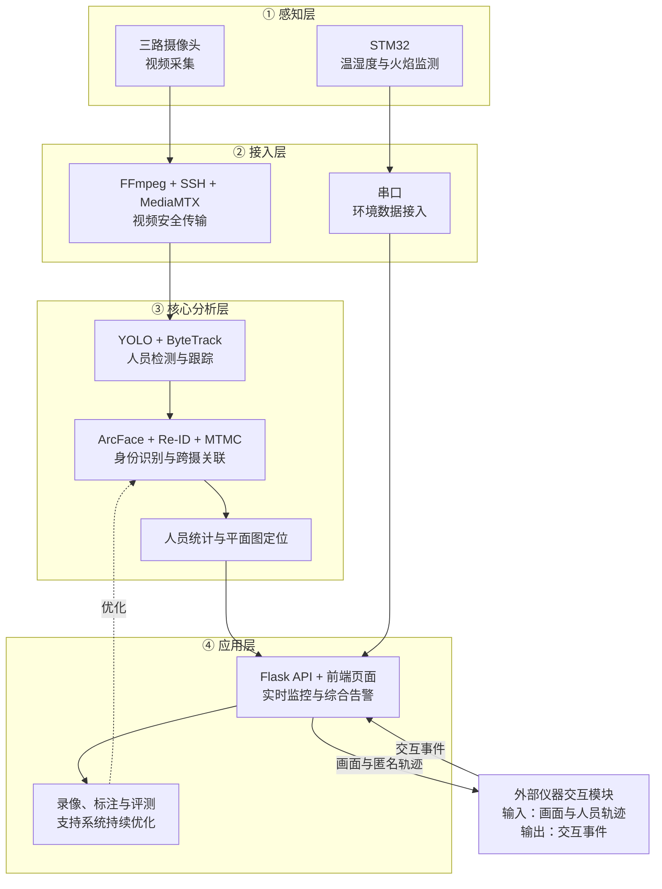

# 项目总体架构

## 汇报讲解

系统分为四层：感知层采集视频和环境数据；接入层负责视频安全传输与串口通信；核心分析层完成人员检测、身份识别、跨摄关联和地图定位；应用层统一展示人员位置、环境状态和告警信息，并利用录像与标注进行评测优化。仪器交互识别作为外部模块，只负责接收画面和人员轨迹并返回交互事件。

## 一句话总结

本项目实现了实验室人员的识别、跨摄跟踪、空间定位和环境安全监测，并接入外部仪器交互能力。
